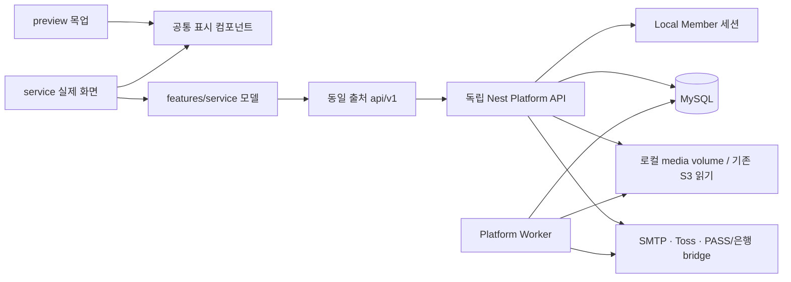

# 실제 서비스 구현 추적

최종 목표: `/preview/*` 목업을 유지하고 `/service/*`에서 동일 표시 컴포넌트를 `/api/v1` 실제 DB API에 연결한다. Cognito 없는 자체 인증, MySQL, 단일 서버 배포. 외부 서비스 자격증명은 환경변수로만 주입한다.

## 계약

응답은 `{success,data,errorMessage,errorCode}`. 성공은 오류 필드 null, 실패는 data null. HTTP 상태코드는 유지한다. 새 API 접두어 `/api/v1`, 파괴적 변경은 `/api/v2`. 금액은 정수 KRW. 클라이언트 권한/가격/인증완료 플래그를 신뢰하지 않는다. 유료 미디어는 서버가 권한을 확인한 뒤 반환한다. 가입은 이메일 증명과 PASS 증명을 서버에서 검증한다.

## 작업 순서 / 완료 체크

- [x] DB 추가 모델과 migration, 격리된 개발 DB
- [x] 버전 API, 응답/오류, 자체 세션, 이메일 인증, PASS 공급자 경계
- [x] 팬: 피드/탐색/프로필/저장/좋아요/팔로우/댓글/메시지/알림/설정/문의/정책
- [x] 스튜디오: 시작/프로필/게시물/미디어/멤버십 버전/가입자/댓글/리포트
- [x] 결제: 서버 주문/결제수단/승인/멱등/구독/갱신/취소/환불
- [x] 정산 원장/계좌/출금 PIN/동시 요청 방지/배치
- [x] 실제 페이지 모델 바인딩 (fixture import 금지)
- [x] 로컬 HTTP/DB 통합검증, 프론트/백엔드 검사, 배포/설정 가이드

## 실행 / 추적 규칙

기존 미커밋 변경을 보존한다. 운영 DB는 절대 migration/seed하지 않는다. 개발은 별도 3307 포트 데이터 디렉터리와 생성한 개발 비밀값을 사용한다. 외부 계정 미설정 시 503 PROVIDER_NOT_CONFIGURED를 반환하며 가짜 완료/결제를 생성하지 않는다. 외부 발송/결제/은행송금 실행은 하지 않는다. 완료 검증과 남은 부분을 이 문서와 PROGRESS.md에 기록한다.

## 현재 코드 구조

- API 상세 계약: `docs/platform-api.md`; 외부 공급자 경계: `docs/provider-contracts.md`; 배포: `infra/platform/README.md`.
- DB 추가: 계정 설정/저장/차단/DM/알림/문의/서비스 문서, 가입 코드·PASS 시도/증명·동의 snapshot, 멤버십 버전, 암호화 billing key·서버 주문·수익 원장·정산 계좌·출금 PIN/authorization/request·worker job·팔로우 변경 이력. 기존 Member/Creator/Posting/Subscription 모델은 보존하고 필드를 추가한다.
- 20261007000000~20261007060000 추가 migration을 작성했다. 기존 로컬 인증 migration을 포함해 격리 개발/테스트 DB에 총 9개 적용. 운영 DB에는 실행하지 않았다.
- 소유권/권한은 API에서 검증하고 핵심 결제·출금·게시물 발행은 행 잠금/transaction으로 처리한다. 이름뿐인 verified boolean을 브라우저에서 받아 처리하지 않는다.
- 가입 조건·정산 조건과 동의 약관 원문을 snapshot으로 고정한다. 과거 조건이 없는 구독은 확인 필요로 표시하며 갱신/권한에 임의 혜택을 만들지 않는다.
- 상태: 주문 pending/processing/paid/failed/refunding/refunded, 출금 requested/processing/paid/rejected. worker는 예약 발행/갱신 정책 재시도/불확실 승인·환불 조회/은행 상태 확인/한국 시간 일일 미디어 정리를 처리한다.

## 로컬 실행 상태와 재개

- 프론트: 127.0.0.1:3010, 기존 Next dev 하나. `/preview` 유지, `/service` 실제 API.
- API: 127.0.0.1:3001. `npm run build` 후 `npm run dev:platform`은 `.local/platform.env`만 읽는다.
- MySQL: 127.0.0.1:3307, `.local/mysql`/`.local/mysql.sock`, DB `crefans_platform_dev`와 `crefans_auth_test`. 생성한 개발 비밀값은 gitignore 대상 `.local/platform.env`에만 있다.
- backend 일반 `.env`는 기존 운영 DB 설정이므로 개발 실행/테스트에 로드하지 않는다. Prisma deploy도 런처에서 DATABASE_URL을 격리 DB로 명시했다.
- 플랫폼 worker는 `node -r dotenv/config dist/src/platform/worker.js dotenv_config_path=.local/platform.env`. 실제 은행 송금·미디어 삭제는 off.
- 프론트 build는 dev .next 손상을 피하려고 임시 checkout 복사본에서 검증한다. 새 실제 모델에 preview fixture import가 없다.

## 검증 기록

- 프론트 layer/type/test: 267개 통과. 외부 계정 없는 production Next build 통과(임시 복사본).
- 자체 인증 기존 통합 테스트: 12개 통과(별도 *_test DB, SMTP loopback 포함).
- 플랫폼 HTTP 통합 테스트: 13개 통과. 특히 프론트 3010의 `/api/v1` 프록시를 통해 재검증.
- 플랫폼 도메인: 이메일 증명/서명/가입·약관 snapshot 3개, 결제 snapshot/정확히 한 번 원장/출금 동시성/계좌 변경 차단/PIN 잠금/카드 재시도 6개, 미디어 dry-run/과거 버전 참조 보존/삭제 멱등 2개, 빌링 등록/암호화/재시도/폐기/비활성 계정 6개.
- 백엔드 Nest build·Prisma generate/migration deploy, Compose 설정 문법 통과.
- 브라우저: 실제 feed/login의 정상 데이터/빈 상태와 기존 `/preview/post/morning` 목업 유지 확인.
- 읽기 전용 개발 DB 이관 감사 7항목 모두 0. worker heartbeat `failures={}` 확인.
- 실제 외부 메일/PASS/결제/은행, 운영 DB, Docker 실제 이미지/TLS/복구/부하 검증은 실행하지 않았다.

## 운영 전 필요한 외부 입력·검증

이 체크리스트의 완료는 코드와 로컬 연결 범위다. 운영 출시 완료를 의미하지 않는다.

1. SMTP/Toss 계정·도메인·사업 정책 값 입력 후 공급사 테스트 환경 검증.
2. PASS/은행 공급자 계약 선택 후 공식 SDK를 내부 bridge에 연결. 계정값만 채우면 이 두 공급자 구현까지 완료되는 것은 아니다.
3. 약관/개인정보/운영 정책·활동 분야를 관리자 API로 등록, 첫 운영 관리자 지정.
4. 과거 회원·가입 당시 snapshot·billing key 암호화·기존 S3 비공개 이관. 이관 감사 CLI는 읽기 전용이다.
5. Docker 실행·TLS·볼륨 권한·DB/media 백업 복구·부하·장애/불확실 결제 운영 절차 검증.
6. 보조 목록의 대규모 서버 페이지 분리, 신규 관리자 UI·세무 증빙/월별 정산 기능은 현재 신규 목업 범위 밖이다.
