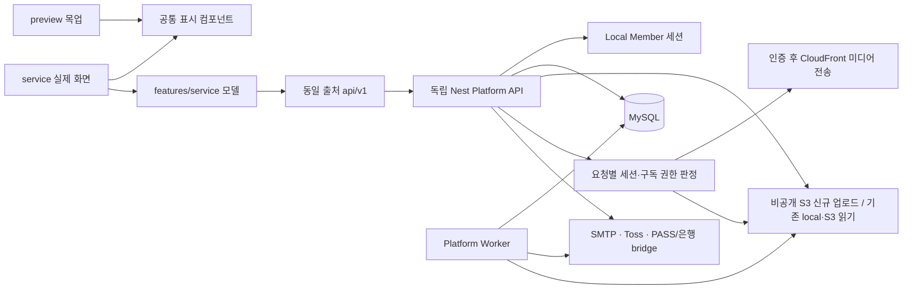

# 실제 서비스 구현 추적

운영 최신 상태(2026-10-25): beans-20261025로 API/worker·팬 프론트·독립 콘솔을 배포했다. 수수료20%/보류7일 version2,21migration·콩 기능 on·BETA_MODE=true,실판매/실출금/광고메일 off다. 초기 로컬검수/설계 당시의 미배포 기록과 구분하며 자세한 변경·오류수정·운영 검증은 [배포 증거](../../crefans_front/docs/audit/bean-deployment-20261025.json)를 따른다.

최신 정책 구현(2026-10-25): [platform-api.md](./platform-api.md#확정-베타-정책-구현-2026-10-25)의 초대·일반 콘텐츠·테스트 결제, 신규 미사용7일 환불, 갱신24시간3회 추가, PG 입금 대사/최소10만원(2026-10-27 상향)/수요일 신규 지급, 광고 동의·수신거부·발송 큐와 공통 이용안내를 적용했다. DB 수수료20%/보류7일은 운영 version2로 발행했다. 베타 관련2개와 콩2개 migration까지 운영21개 적용했다. 실제 SMTP/PG/은행 금융 검증은 이번 배포에서 실행하지 않았다. 약관은 코드 초안을 갱신했지만 signupReady 차단 조건을 유지한다.

역할별 출시 검수 기준은 프론트 `docs/release-test-scenarios.md`에 있다. 해당 검수의 미실행/차단 항목을 기존 로컬 테스트 결과로 통과 처리하지 않는다.

최종 목표: `/preview/*` 목업을 유지하고 `/service/*`에서 동일 표시 컴포넌트를 `/api/v1` 실제 DB API에 연결한다. Cognito 없는 자체 인증, MySQL, 단일 서버 배포. 외부 서비스 자격증명은 환경변수로만 주입한다.

## 계약

응답은 `{success,data,errorMessage,errorCode}`. 성공은 오류 필드 null, 실패는 data null. HTTP 상태코드는 유지한다. 새 API 접두어 `/api/v1`, 파괴적 변경은 `/api/v2`. 금액은 정수 KRW. 클라이언트 권한/가격/인증완료 플래그를 신뢰하지 않는다. 유료 미디어는 서버가 권한을 확인한 뒤 반환한다. 가입은 이메일 증명과 PASS 증명을 서버에서 검증한다.

## 작업 순서 / 완료 체크

- [x] DB 추가 모델과 migration, 격리된 개발 DB
- [x] 버전 API, 응답/오류, 자체 세션, 이메일 인증, PASS 공급자 경계
- [x] 팬: 피드/탐색/프로필/저장/좋아요/팔로우/댓글/메시지/알림/설정/문의/정책
- [x] 스튜디오: 시작/프로필/게시물/미디어/멤버십 버전/가입자/댓글/리포트
- [x] 결제: 서버 주문/결제수단/승인/멱등/구독/갱신/취소/환불
- [x] 정산 원장/계좌/출금 PIN/동시 요청 방지/배치
- [x] 실제 페이지 모델 바인딩 (fixture import 금지)
- [x] 로컬 HTTP/DB 통합검증, 프론트/백엔드 검사, 배포/설정 가이드

## 실행 / 추적 규칙

기존 미커밋 변경을 보존한다. 운영 DB는 절대 migration/seed하지 않는다. 개발은 별도 3307 포트 데이터 디렉터리와 생성한 개발 비밀값을 사용한다. 외부 계정 미설정 시 503 PROVIDER_NOT_CONFIGURED를 반환하며 가짜 완료/결제를 생성하지 않는다. 외부 발송/결제/은행송금 실행은 하지 않는다. 완료 검증과 남은 부분을 이 문서와 PROGRESS.md에 기록한다.

## 현재 코드 구조

- API 상세 계약: `docs/platform-api.md`; 외부 공급자 경계: `docs/provider-contracts.md`; 배포: `infra/platform/README.md`.
- DB 추가: 계정 설정/저장/차단/DM/알림/문의/서비스 문서, 가입 코드·PASS 시도/증명·동의 snapshot, 멤버십 버전, 암호화 billing key·서버 주문·수익 원장·정산 계좌·출금 PIN/authorization/request·worker job·팔로우 변경 이력. 기존 Member/Creator/Posting/Subscription 모델은 보존하고 필드를 추가한다.
- 20261007000000~20261007060000 추가 migration을 작성했다. 당시 기존 로컬 인증 migration을 포함해 격리 개발/테스트 DB에 총 9개 적용. 이후 결제 수명주기 migration이 추가됐으며 현재 파일 전체는 코드 추출 계약에 기록한다. 운영 DB에는 실행하지 않았다.
- 소유권/권한은 API에서 검증하고 핵심 결제·출금·게시물 발행은 행 잠금/transaction으로 처리한다. 이름뿐인 verified boolean을 브라우저에서 받아 처리하지 않는다.
- 가입 조건·정산 조건과 동의 약관 원문을 snapshot으로 고정한다. 과거 조건이 없는 구독은 확인 필요로 표시하며 갱신/권한에 임의 혜택을 만들지 않는다.
- 상태: 주문 pending/processing/paid/failed/refunding/refunded, 출금 requested/processing/paid/rejected. worker는 예약 발행/갱신 정책 재시도/불확실 승인·환불 조회/은행 상태 확인/한국 시간 일일 미디어 정리를 처리한다.

## 로컬 실행 상태와 재개

- 프론트: 127.0.0.1:3010, 기존 Next dev 하나. `/preview` 유지, `/service` 실제 API.
- API: 127.0.0.1:3001. `npm run build` 후 `npm run dev:platform`은 `.local/platform.env`만 읽는다.
- MySQL: 127.0.0.1:3307, `.local/mysql`/`.local/mysql.sock`, DB `crefans_platform_dev`와 `crefans_auth_test`. 생성한 개발 비밀값은 gitignore 대상 `.local/platform.env`에만 있다.
- backend 일반 `.env`는 기존 운영 DB 설정이므로 개발 실행/테스트에 로드하지 않는다. Prisma deploy도 런처에서 DATABASE_URL을 격리 DB로 명시했다.
- 플랫폼 worker는 `node -r dotenv/config dist/src/platform/worker.js dotenv_config_path=.local/platform.env`. 실제 은행 송금·미디어 삭제는 off.
- 프론트 build는 dev .next 손상을 피하려고 임시 checkout 복사본에서 검증한다. 새 실제 모델에 preview fixture import가 없다.

## 초기 구현 검증 기록 (2026-10-07, 최신 실행은 증거 파일 참조)

- 프론트 layer/type/test: 267개 통과. 외부 계정 없는 production Next build 통과(임시 복사본).
- 자체 인증 기존 통합 테스트: 12개 통과(별도 *_test DB, SMTP loopback 포함).
- 플랫폼 HTTP 통합 테스트: 13개 통과. 특히 프론트 3010의 `/api/v1` 프록시를 통해 재검증.
- 플랫폼 도메인: 이메일 증명/서명/가입·약관 snapshot 3개, 결제 snapshot/정확히 한 번 원장/출금 동시성/계좌 변경 차단/PIN 잠금/카드 재시도 6개, 미디어 dry-run/과거 버전 참조 보존/삭제 멱등 2개, 빌링 등록/암호화/재시도/폐기/비활성 계정 6개.
- 백엔드 Nest build·Prisma generate/migration deploy, Compose 설정 문법 통과.
- 브라우저: 실제 feed/login의 정상 데이터/빈 상태와 기존 `/preview/post/morning` 목업 유지 확인.
- 읽기 전용 개발 DB 이관 감사 7항목 모두 0. worker heartbeat `failures={}` 확인.
- 실제 외부 메일/PASS/결제/은행, 운영 DB, Docker 실제 이미지/TLS/복구/부하 검증은 실행하지 않았다.

## 운영 전 필요한 외부 입력·검증

이 체크리스트의 완료는 코드와 로컬 연결 범위다. 운영 출시 완료를 의미하지 않는다.

1. SMTP/Toss 계정·도메인·사업 정책 값 입력 후 공급사 테스트 환경 검증.
2. PASS/은행 공급자 계약 선택 후 공식 SDK를 내부 bridge에 연결. 계정값만 채우면 이 두 공급자 구현까지 완료되는 것은 아니다.
3. 약관/개인정보/운영 정책은 코드 원본의 미해결 사항을 해소해 시행본으로 릴리스하고, 활동 분야와 첫 운영 관리자는 관리자 설정으로 관리.
4. 과거 회원·가입 당시 snapshot·billing key 암호화·기존 S3 비공개 이관. 이관 감사 CLI는 읽기 전용이다.
5. Docker 실행·TLS·볼륨 권한·DB/media 백업 복구·부하·장애/불확실 결제 운영 절차 검증.
6. 보조 목록의 대규모 서버 페이지 분리, 신규 관리자 UI·세무 증빙/월별 정산 기능은 현재 신규 목업 범위 밖이다.

### 2026-10-08 결제 수명주기 보완

중복 승인·응답 유실·DB 반영 실패·15일 경과 미확인 결제·카드 교체 재시도·갱신 중 해지·월말 갱신 anchor·이전 회차/현재 회차 환불·환불 결과 검증·출금 예약과 잔액 변경을 구현하고 격리 DB에서 검증했다. 테스트 명령은 `npm run build`, `npm run test:platform:domain`(54), 일반 API 실행 후 `npm run test:platform`(19), 프론트 `npm run check`(273). 상세 범위와 미결정 정책은 `provider-contracts.md` 결제 수명주기 검증 참조. 실제 공급사 테스트 및 전체97개 출시 검수는 별도다.

### Playwright E2E 테스트 런타임 (2026-10-08)

프론트 `playwright.config.ts`에서 `npm run build && node tests/e2e-server.cjs`를 실행한다. 테스트 전용 loopback API3012·제어 토큰·공급사 대역이며 운영 src/엔트리에서는 사용하지 않는다. 원본 .local/platform.env 연결이 127.0.0.1:3307/crefans_platform_dev인지 검사한 뒤 **crefans_platform_e2e**로만 연결을 전환한다. 별도 DB 생성/migration과 fixture 정리는 이 E2E DB에만 적용한다. migrate deploy는 임시 schema/migrations 복사본에서 실행해 일반 .env를 로드하지 않는다. 로컬 DB에 E2E schema만의 권한을 부여했고 운영 DB는 변경하지 않았다.

역할별 합성 회원·명시적 테스트 정책·멤버십/전용 글/카드/출금용 수익을 준비하고 각 테스트와 종료 시 해당 fixture만 정리한다. fixture 제어는 가입 코드/서명된 PASS 완료·승인 응답 유실/카드 거절·해당 구독 갱신·해당 출금 지급·세션 만료·첨부 권한을 재현한다. 운영 scheduler 전체 실행/실제 공급사 성공을 증명하지 않는다. 반복 명령·결과 파일·CI 준비는 프론트 docs/service-api-binding.md의 Playwright 절 참조. SIGKILL은 finally를 보장하지 않으므로 E2E DB에만 잔여 fixture를 확인한다.

### 클라우드·영상 화질 조사 (2026-10-08, 배포/구현 미실행)

전제: 한국 시청자를 중심으로 초기 출시, 자체 인증과 단일 앱 원서버 유지. 월 업로드 분량/시청 시간/동시 시청자/장애 복구 목표는 미확정이다. 아래 선택은 기술 권장안이며 계정별 견적·콘텐츠 허용 승인이 아니다.

당시(2026-10-08) 신규 영상 업로드는 media.controller.ts에서 MP4/WebM 최대300MiB의 컨테이너 헤더를 확인한 뒤 로컬 영속 volume에 파일 하나를 저장한다. 코덱 정규화/ffprobe 정밀 검사/자동 인코딩/HLS/ABR/CDN은 구현되어 있지 않다. 기존 S3 변환본 읽기는 신규 업로드 파이프라인과 별개이며 720p를 먼저 선택하는 코드다. 파일 GET/HEAD/Range 접근 검사는 기존 API 경유 상태다.

권장: AWS 서울 EC2에 현재 Next/Nest/worker를 유지하고 미디어는 비공개 S3+CloudFront로 분리. 자체 인증을 유지하며 Cognito를 다시 도입할 필요가 없다. DB까지 한 서버에 두는 초기 구성은 가능하지만 결제 원장의 복구를 위해 외부 백업/binlog/복원 검수 필요; 예산이 허용되면 RDS MySQL의 자동 백업/PITR와 Multi-AZ를 비교한다. 단일 앱 서버 자체의 장애점은 남는다. 영상 인코딩은 별도 queue/MediaConvert로 처리하여 결제 API와 CPU를 경쟁시키지 않는다. 한국 대상 국내 리전 선택과 전 세계 CDN 캐시의 개인정보 국외 처리 판단은 별도로 검토한다.

확인된 공급사 정보:
- AWS CloudFront 공식 가격: Free0달러/100GB, Pro15달러/월·10M요청·50TB·S3크레딧50GB, Business200달러/월·125M요청·50TB·S3크레딧1TB. Pro에는 uptime SLA가 없고 Business에는 있다. 가격은 distribution 단위이며 EC2/DB/인코딩/초과 저장/세금 등 전체 제품 비용이 아니다. 계정 eligibility와 기능 제약 확인 필요. 정액 allowance 초과 요금이 없더라도 지속 초과 시 성능 조정/가격 구조 변경 가능하므로 무제한 영상 서비스로 해석하지 않는다.
- NCP 공식 한국 요금표: Global Edge 한국 전송0~10TB84원/GB, 요청10,000건당10원, 선택 OriginShield18원/GB, VAT별도. VOD Station AVC30fps 이하1-pass 출력 분당 SD9원/HD17원/FHD32원. 저장·채널/CDN 등 별도. 공식 페이지의 동적 표는 검색에 색인된 공식 표로 교차 확인했으며 계약 전 콘솔/견적 재확인 필요.
- Cloudflare Stream: 인코딩/패키징/배포를 관리하고 HLS/DASH 및 서명 인증 제공. 저장1,000분당5달러, 전송1,000분당1달러. 앱/DB 호스팅과 별개인 영상 서비스이며 데이터 위치/콘텐츠 허용/최대 화질 요구를 확인해야 한다. 관리 부담 최소화 대안이다.

화질 권장: 원본1개를 비공개 보관하고 1080/720/480급 HLS 변환본을 생성, 기본 자동+고화질 수동 선택. 세로 영상은 비율/회전을 유지하고 원본보다 확대하지 않는다. 4K/복수 코덱/DRM은 요구와 비용 확인 후 별도 판단. 480급은 나쁜 네트워크에서 재생을 유지하기 위한 fallback이며 유료 회원에게 낮은 화질을 강제하는 정책이 아니다. Apple HLS 지침은 복수 비트레이트를 요구하며 ABR은 대역폭에 맞춰 선택한다. 출시 소규모 임시 단계에는 정규화된 단일 MP4도 가능하나 ABR 제공으로 표시해서는 안 된다.

계산 예시(측정/견적 아님): 영상 비트레이트6/3/1Mbps·10분은 오디오/패키징 제외450/225/75MB. 시청 시 세 화질을 모두 내려받는 것이 아니므로 저장량 증가는 시청 전송량3배를 뜻하지 않는다. 6Mbps10분을1만 번 끝까지 보면 약4,500GB, NCP 첫 구간 전송료만378,000원(VAT/요청/저장/인코딩/채널 제외). NCP 동일10분3출력 단일패스 인코딩은 (32+17+9)*10=580원에 별도 비용. 저장 원본의 비트레이트는 예시와 다를 수 있다.

권한 경계: 비공개 S3 원본은 OAC를 통해 CDN에서만 읽고, 서버가 현재 작성자/해당 상품 구독/공개 기간/성인 인증/계정 상태를 확인한 후 해당 미디어 경로의 짧은 재생 권한을 발급한다. HLS master/variant playlist/segment와 암호화 시 key까지 보호한다. AWS는 복수 HLS 파일에 signed cookies를 권장한다. 여러 유료 미디어가 한 피드에 있는 경우 경로별 Cookie/CORS/권한 범위 충돌 검증 필요, 단일 blanket 권한을 부여하지 않는다. 기존 private,no-store API 정책은 유지하되 CDN은 인증을 통과한 파일만 공유 캐시하도록 별도 설계해야 한다. 서명은 bearer 권한이므로 만료 전 공유/권한 철회 지연이 생길 수 있으며 짧은 TTL+재검사, 즉시 차단 요구 시 edge 검증이 필요하다. DRM/복제 방지와 접근제어는 구분한다.

기존 성인 콘텐츠 질문 관련: AWS AUP는 불법 활동·권리 침해·아동 성착취 등을 금지한다. 합법 성인 콘텐츠 전체가 허용된다고 보장하는 문구로 해석하지 않는다. 국내 정보통신망법44조의7(시행2026-07-07)은 음란 정보 유통을 금지한다. 성인 인증/유료 접근/해외 저장만으로 허용 여부를 결정할 수 없다. 실제 콘텐츠 유형을 확정한 뒤 공급사/PG 허용 범위와 해당 운영 법률 적용을 확인해야 한다. NCP의 검색된2021 약관 PDF를 현행 계약으로 단정하지 않았다.

공식 근거(확인일2026-10-08):
- [CloudFront 요금](https://aws.amazon.com/cloudfront/pricing/), [정액 요금 eligibility/제약/초과 정책](https://docs.aws.amazon.com/AmazonCloudFront/latest/DeveloperGuide/flat-rate-pricing-plan.html), [AWS Service Terms3.2](https://aws.amazon.com/service-terms/)
- [NCP 한국 요금표](https://www.ncloud.com/charge/region/ko), [Global Edge 인증](https://guide.ncloud-docs.com/docs/en/globaledge-overview)
- [MediaConvert 요금/출력별 과금](https://aws.amazon.com/mediaconvert/pricing/), [서울 지원](https://docs.aws.amazon.com/general/latest/gr/mediaconvert.html)
- [Cloudflare Stream 요금](https://developers.cloudflare.com/stream/pricing/), [영상 처리](https://developers.cloudflare.com/use-cases/media-streaming/video-delivery/)
- [Apple HLS](https://developer.apple.com/streaming/), [HLS 저작 지침](https://developer.apple.com/documentation/http-live-streaming/hls-authoring-specification-for-apple-devices/)
- [S3 OAC](https://docs.aws.amazon.com/AmazonCloudFront/latest/DeveloperGuide/private-content-restricting-access-to-s3.html), [signed cookies 선택](https://docs.aws.amazon.com/AmazonCloudFront/latest/DeveloperGuide/private-content-choosing-signed-urls-cookies.html), [서명 만료](https://docs.aws.amazon.com/AmazonCloudFront/latest/DeveloperGuide/private-content-signed-cookies.html)
- [RDS 자동 백업/PITR](https://docs.aws.amazon.com/AmazonRDS/latest/UserGuide/USER_WorkingWithAutomatedBackups.html), [Multi-AZ](https://docs.aws.amazon.com/AmazonRDS/latest/UserGuide/Concepts.MultiAZSingleStandby.html)
- [AWS AUP](https://aws.amazon.com/aup/), [정보통신망법44조의7](https://www.law.go.kr/lsLawLinkInfo.do?chrClsCd=010202&lsJoLnkSeq=1000085004)

남은 사업 판단: 최대 제공 화질/원본 보관 기간·월 업로드/시청 예산·DB/앱 장애 복구 목표·콘텐츠 범위·서명 철회 지연 허용 범위. 이번에는 코드/클라우드 자원/외부 계정/배포를 변경하지 않았다.

### 성장 단계별 월 인프라 예산 계산 (2026-10-08)

사용자 조건: 초기5/중간50/대형100/초대형1000 구독자 크리에이터가 동일 비율. 총 크리에이터 수가 주어지지 않아4/40/100명 가정. 4명마다 구독1155건, 평균288.75건/크리에이터. 동일 팬의 복수 구독은 중복 포함하며 아래 시청량은 각 구독 관계당 가정이다. 월 시청100/300분, 평균 전달4Mbps(화질별 실제 평균은 미측정), 전송 여유10%,6초HLS영상조각·요청 여유20%. 별도 audio segment·썸네일·앱/API 요청이 늘어나면 요청량이 더 커질 수 있다.

업로드: 크리에이터마다 월10분 영상4개=40분. 원본4Mbps+재생4/2/1Mbps 합계11Mbps, 월3.3GB·6개월 누적19.8GB/명, 과거 전체6개월분을 월말까지 보관하는 보수적 모델. 이미지·실제 원본 고비트레이트·버전 복제·전 기간 보관은 추가된다. 원본10분4Mbps는 약300MB여서 현재300MiB 업로드 제한과 맞지만 고비트레이트면 제한 변경 필요.

소형 비용 모델: AWS서울 Lightsail IPv4 Linux4GB24달러/8GB44달러/16GB84달러에 Next/Nest/MySQL/worker, 영상은비공개S3+CloudFront+MediaConvert. 기존 EC2권장안을 자본금 없는 초기의 VM고정비 관점에서 Lightsail 대안으로 계산한 것이며 실제 이전/성능 검증은 하지 않았다. DB같은VM은 외부 백업/로그 복원 검증 필수; VM규격은 예산 가정이고 해당 회원 규모의 처리능력 보장이 아니다. 운영서비스는 production build로 실행, 같은서버에서 영상변환하지 않음. 영상트래픽을 Lightsail 포함전송량으로 계산/프록시하지 않는다.

공식 AWS 서울 Price List(2026-10-08 조회): MediaConvert Basic AVC30fps 이하 SD/HD 정상화분단가0.0085달러, HD승수2/SD1. 1080/720/480 세출력은 40*(2+2+1)*0.0085=1.70달러/명/월. S3Standard첫50TB0.025달러/GB월, GET0.00000035달러/건·PUT0.0000045달러/건. Lightsail snapshot0.05달러/GB월. 백업 예산4/40/100명별5/10/15달러, 요청/메일/로그 등 소규모 예비비5/10/15달러를 임의 편성. 실제 원본 분량/요청 cache miss/SMTP 서비스 요금/backup 증가에 따라 달라진다. CloudFront S3storage크레딧은 아래 예산에서 빼지 않아 보수적이며 적용 시 낮아진다. domain등록비·PASS·PG/은행비용·인건비·운영 HA/관리형DB 제외, 무료체험/프로모션 미반영.

환산은 현재환율확정값이 아닌 예산환율1달러1400원+VAT10%=1540원/달러. 공식값·가정·계산값 구분.

| 총크리에이터 | 각등급인원 | 구독합계 | 월100분전송TB/요청M | 월100분 총USD/예산KRW | 월300분전송TB/요청M | 월300분 총USD/예산KRW |
| --- | --- | --- | --- | --- | --- | --- |
|4|각1|1155|3.8115/1.386|57.78/88981|11.4345/4.158|57.78/88981|
|40|각10|11550|38.115/13.86|351.80/541772|114.345/41.58|2401.80/3698772|
|100|각25|28875|95.2875/34.65|2583.50/3978590|285.8625/103.95|6333.50/9753590|

CDN구성:4명Pro15달러;40명100분Business200달러(요청10M초과),300분Premium125TB2250달러;100명100분Premium125TB2250달러,300분Premium350TB6000달러. 영상외앱트래픽이 같은distribution이면 추가 고려. 이는 sustained예상 사용량에 맞춘 보수적 plan선택이며 allowance넘는즉시자동청구/업그레이드가 발생한다는 뜻이 아니다. 공식은 초과추가요금없음/일회성급증허용/지속초과성능조정가능이라고 안내한다. 50TB 넘는다고 비용이 선형 증가하지 않는 구간을 강조한다. 대규모에는 negotiatedCDN/다른영상서비스 및 실제 시청 평균으로 재견적해야 하며 위 Premium가격이 유일한필수비용은 아니다.

4명100분57.78달러 내역:VM24+CDN15+인코딩6.80+영상저장1.98+백업5+요청/메일/로그예비5.40명100분:VM44+CDN200+인코딩68+저장19.80+백업10+예비10.100명100분:VM84+CDN2250+인코딩170+저장49.50+백업15+예비15.

민감도:100명/월100분의 실제평균전달률이2Mbps면47.64375TB·요청34.65M, Business200달러로총533.50달러=821590원(약82만원)이 된다. 평균4Mbps의약398만원과큰차이이며 시청동작/자동화질의 실제측정없이 특정비용을확정하면안된다. 40명/100분10초조각은 예시 요청8.316M으로Pro기준에들어올수있지만 재생/탐색 품질 및앱/추가요청 검수 없이 이 값을확정하지않는다.

자본금없는초기제안:크리에이터1~4/구독5~100건의초기검증은VM24+CDN15+외부백업/소규모요청/영상변환으로월8~10만원정도를예산에둔다. Pro SLA없음, 앱/DB VM단일장애점이남음. 원격무료운영/정식출시가능성을보장하지않는다. 월10분4개등업로드량한도, 고화질원본무제한보관하지않기(보존정책먼저확정), 화면밖전체영상미리받기금지, 영상은CDN에서만전송. 비용경보50/80/100%, 업로드쿼터/변환작업한도/스토리지추이모니터링을권장; AWSBudget알림은자동과금상한이아니다. 추후실제지표에따라DB분리와CDN계약재검토. 변환본이세개라는이유로시청전송량3배가되지않는다.

근거(조회2026-10-08): [Lightsail 요금](https://aws.amazon.com/lightsail/pricing/), [CloudFront 요금](https://aws.amazon.com/cloudfront/pricing/), [계획별요청/전송 allowance·Premium상위용량](https://docs.aws.amazon.com/AmazonCloudFront/latest/DeveloperGuide/flat-rate-pricing-plan.html), [MediaConvert정상화승수](https://aws.amazon.com/mediaconvert/pricing/), [서울MediaConvert 공식 Price List](https://pricing.us-east-1.amazonaws.com/offers/v1.0/aws/AWSElementalMediaConvert/20260911134114/ap-northeast-2/index.json), [서울S3 공식 Price List](https://pricing.us-east-1.amazonaws.com/offers/v1.0/aws/AmazonS3/20260928230416/ap-northeast-2/index.json). 이번에는 비용계산/문서기록만했으며구매/배포/과금설정변경없음.

## 운영 이벤트·보안 보고 (2026-10-21 구현)

- `operations-events.ts`/`PlatformOperationalEvent`: 가입, 첫 구독/정기갱신, 사용자 구독 해지예약, 콘텐츠 생성/수정/삭제, 팬·크리에이터 프로필 변경을 사업 트랜잭션 안에 기록. 중복 승인/이미 해지된 구독 재요청은 새 이벤트를 만들지 않는다. 예약 게시 공개도 콘텐츠 수정으로 기록한다.
- `operations.service.ts`: 별도 전송 lease, DB 큐, 발송 실패/429 backoff(모든 API/worker가 공유하는 채널 cooldown), `[crefans] operations` 채널 이름·유형 검증. API/worker가 큐를 공유한다. 원격 응답 유실/프로세스 중단에서는 재발송될 수 있는 at-least-once이고 Telegram 표시 ID로 같은 이벤트를 식별한다. 알림의 exactly-once를 보장하지 않는다. 공급자 장애 시 DB 원장 상태나 결제 결과를 취소하지 않는다.
- 오류는 HTTP5xx와 실행 중 처리되지 않은 예외를 보고. 이름/상태/route template/접속IP/peerIP/requestID만, 본문/query/cookie/인증정보/결제정보/이메일/실명/오류 원문 메시지·stack은 보내지 않는다. 초기 DB 연결 실패/프로세스 OOM·강제종료는 앱 자체 전송으로 보장할 수 없어 외부 가용성 모니터링이 별도로 필요하다.
- `jobs.service.ts`/worker: 매 실행 PlatformJob 기록, 처리시도·정리·실패 즉시 큐, 정상 무작업은 DB 저장된 시계 기준1시간 요약(재시작으로 초기화하지 않음). `processed`는 작업 처리 단위이며 결제 성공/송금 완료 건수라는 의미가 아니다. 30일이 지난 실행 기록/전송완료 큐/오래된 만료 IP 상태 정리. 미전송 알림은 장애 복구를 위해 유지한다.
- `security.service.ts`: `/api/v1`의 구조화 query만 고신뢰 SQL 패턴 검사. 첫403, 동일 IP10분2회면24시간 API403. DB 행잠금/영속 상태와 outbox 원자 저장, 탐지10분 중복 억제, 만료 후 첫 요청에서 해제 알림. loopback 차단 제외. 자유 텍스트·JSON·파일 본문·정적 페이지/다른 경로는 검사 대상이 아니며 DB parameter binding의 대체가 아니다. 현재 Crefans 방어는 API 접근 제한이며 NC의 호스트80/443 방화벽 차단과 다르다.
- request-context는 AsyncLocalStorage. socket IP를 기본으로, 명시한 정확한 프록시 IP에서만 X-Crefans-Client-IP를 신뢰. Caddy가 실제 remote_host로 덮어쓴다. CloudFront 도입 시 짧은 HMAC으로 검증한 viewer IP만 이 신뢰 경계 안에서 별도로 인정한다. 서명 없는 IP 헤더는 신뢰하지 않으며 API/worker/Next의 private 포트를 열지 않는다.

일반 테스트에서는 CREFANS_E2E=true로 자동 전송 타이머를 끄고 전송기는 대역으로 직접 호출한다. 검증은 `npm run test:operations`, `python3 tests/platform-proxy.py`; 전자는 로컬 격리 DB·공급자 대역, 후자는 실제 Caddy 컨테이너+echo upstream이다. 전용 봇 키/게시 권한·실제 수신과 AWS 배포는 별도 확인 대상이다. 최신 결과는 PROGRESS와 프론트 감사 증거를 따른다.

근거 확인2026-10-21: [OWASP Logging](https://cheatsheetseries.owasp.org/cheatsheets/Logging_Cheat_Sheet.html)의 비밀정보 제외/상관ID, [OWASP SQL Injection Prevention](https://cheatsheetseries.owasp.org/cheatsheets/SQL_Injection_Prevention_Cheat_Sheet.html)의 매개변수 바인딩 우선, [Caddy reverse_proxy](https://caddyserver.com/docs/caddyfile/directives/reverse_proxy)의 remote_host/헤더 설정, [Telegram FAQ](https://core.telegram.org/bots/faq#my-bot-is-hitting-limits-how-do-i-avoid-this)의 chat 전송 제한을 적용했다. 2회/10분/24시간과 30일 보존은 이 구현의 보수적 기본값이며 법정 의무/업계의 유일한 정답으로 단정하지 않는다.

## 2026-10-22 사고 추적 로그 구현

독립 감사 원장·요청/오류 추적·관리자 조회/변경·금융/SMTP 시도·콘솔 검색·브라우저 보고를 추가했다. 기존 Telegram outbox와 30일 정리만으로 감사 기록을 유지하던 범위를 보완한다. [기록 범위와 운영 경계](./operational-logging.md), [실행 증거](./logging-implementation-20261022.json)를 따른다. 현재 작업은 로컬 검증이며 운영 migration/이미지/CloudWatch·외부 감시는 미적용이다.

### 정기결제 카드 상태와 복구

2026-10-22: `billing_methods.unavailable_at/unavailable_reason`과 `billing_notices` outbox migration 추가. 분실·정지 등 확정 실패는 카드 차단, 제한 기간 내 교체 복구, 미결제 권한 차단, 기한/횟수 종료 후 갱신 중단. `PlatformJobsService`의 `billing-notices` 작업은 실패·갱신중단 메일을 재전송하며 운영/감사 기록을 보존한다. 기존 가입/갱신/해지 outbox와 별도로 이메일 접수 상태를 추적한다. 구체 계약·설정 해석·검증/실공급사 한계는 `docs/provider-contracts.md`와 `docs/platform-api.md` 최신 절에 기록한다.

### 2026-10-22 비공개 미디어 전환

신규 업로드의 S3 저장, 요청별 세션/구독 검사, 권한/열람 기록 보존과 실제 AWS 검증을 [비공개 미디어 운영](./private-media.md)에 정리한다. 위 10월8일 로컬 저장/CDN 미구현 내용은 당시 조사 기록이다. 단일 파일 방식은 유지하며 HLS·ABR·다중 화질 인코딩을 추가한 작업은 아니다.

2026-10-22 추가 정정: 공유 링크의 비구독 접근 차단을 위해 CDN 서명 URL 전달을 폐기했다. 이후 승인된 CDN 전환은 viewer-request의 현재 세션·구독 검사 후 전송하는 구조이며 서명 URL을 다시 허용하지 않는다. 현재 배포 단계·검증·비용 영향은 비공개 미디어 운영 문서를 따른다.

## 코드 관리 약관 (2026-10-22)

원본은 [legal-documents.ts](../src/platform/legal-documents.ts)다. `GET /api/v1/common`은 terms/privacy/policy를 코드에서 반환하고 DB에서는 공지·FAQ만 사용한다. `bootstrap.account.agreements`는 동일 약관/개인정보처리방침, 별도의 가입 처리 안내·선택 마케팅 문서와 내용 해시를 제공한다. 공개 페이지와 가입 모달은 프론트 `LegalDocumentBody`를 공유한다. ServiceDocument의 예전 약관 행은 무시하며 기존 동의 기록은 삭제하지 않는다. 관리자 `/documents` 조회/작성은 공지·FAQ만 허용하고, 기존 약관 ID를 공지로 바꿔 수정하는 우회도 거부한다.

가입 입력 `policyVersions`는 표시된 terms/privacy 및 선택한 경우 marketing의 `버전:SHA-256`을 그대로 전달해야 한다. 서버는 현재 시행본과 일치하지 않으면 `POLICY_VERSION_CHANGED`(409)로 거부한다. 개인정보 버전은 전체 처리방침과 별도 가입 안내 둘을 함께 해시한다. 가입 트랜잭션은 이메일/PASS 증명 사용과 함께 문서 본문·해시·확인/동의 종류를 member_consents에 보존하며 실패 시 증명 사용도 롤백한다. 개인정보 처리방침 확인을 포괄적인 개인정보 동의로 기록하지 않는다. 선택 마케팅에 동의하지 않아도 가입 가능하다.

현재 릴리스는 **운영 공개본**2026-10-22.1이며 공개일2026-10-22, 신규 가입 적용 시행일은 null이다. 문서 공개와 가입 수락 준비를 구분한다. 실사업자 자료와 사용자 확인으로 운영자를 반영했으나, 탈퇴 후 파기·분리 보관, 국외이전의 실제 국가/법인/연락처/보유기간/법적 근거 및 콘텐츠 허용 범위가 남아 있다. 가입 기준은 사용자 지시에 따라 생일 기준 만19세 이상으로 확정했다. `published`·시행일·blockers를 함께 검사하므로 문서가 공개되어 있어도 미해결 항목/시행일미정/미래시행이면 가입하거나 가입인증메일을 보내지 못한다. 기존 로그인·비밀번호 복구·미디어 권한은 유지한다. 테스트에는 `tests/legal-fixture.cjs`가 격리 DB와 CREFANS_E2E를 확인한 후 발행본 대역을 주입하며 제품 환경변수로 미완성 절차를 활성화하는 우회는 없다.

### 현재 현황과 시행 전 필요한 보완

| 범위 | 코드로 확인한 현황 | 시행 전 합격 조건 |
| --- | --- | --- |
| 운영자 | 로컬 사업자등록정정 제출서와 grade 회사 공개정보 일치 | 통신판매업 신고번호/적용 여부 확인. 실제 증명서 원본은 리포에 넣지 않음 |
| 비용 | 총20%·보류7일 확정, 성공수익 원미만 절사·전액환불 fees/net 0 | 운영 DB version 정책 적용, PG 실입금·계좌·세무 사실 검증 |
| 탈퇴·파기 | service.withdrawAccount는 enabled=false와 세션 삭제. 인증/본인확인 만료값이 파기 시점은 아님 | 일반 계정/콘텐츠와 법정 거래기록 분리, 항목별 기간·파기 잡/수동 절차와 삭제 대조 검사 |
| 로그 | audit-retention 요청 기본7일, 그 외 기본0(보존대기). outbox 완료자료30일 정리, 외부 알림 사본 별도 | 실제 runtime/외부 보관까지 목적·기간·삭제를 대조, 무기한 보유를 법정5년으로 포장하지 않음 |
| AWS | EC2/DB/S3 원본 서울, CloudFront/Lambda@Edge 글로벌 처리 | 실제 이전 국가 목록·수탁법인/연락처·항목·기간·근거·거부 절차 검증 |
| Google | Workspace SMTP로 수신 이메일과 안내 본문 처리 | 계정 계약·리전·보유 정책 확인. 미국/유럽 선택 가능성을 현재 설정으로 추정하지 않음 |
| Telegram | 운영/보안 알림에 IP·ID·처리 결과 전송, 원문/자격정보 제외 | 실제 처리국가·보관/삭제·적법 근거 확인 또는 개인 식별정보 외부 전송 제거를 별도 결정 |
| 가입 연령 | 생일 기준 만19세 이상 확정. 서명된 공급사 결과와 가입 DB proof에서 이중 확인, 자가신고 무시 | false/누락/문자열/위조 거부·실패 시 증명 미소모는 로컬 검증. 실제 PASS 공급사의 생일 경계 판정은 연결 후 확인 |
| 환불 | 미사용 전액환불 API, UI는 고객센터; 갱신해지는 기간말까지 유지 | 페이지 제공 기록을 법정 철회권 포기와 동일시하지 않음. 실운영 PG 검증은 별도 |

공식 근거 확인일2026-10-22: 맥북의 개인정보보호위원회 「개인정보 처리방침 작성지침」2026.4(본문12·24·31~36·42~48·72·83~84쪽), [개인정보법 국외이전](https://law.go.kr/lsLinkCommonInfo.do?lsJoLnkSeq=1020398611)(2026.9.11 시행), [전자상거래 거래기록](https://www.law.go.kr/lsLinkCommonInfo.do?lsJoLnkSeq=1018638379)(2026.7.21 시행), [AWS 데이터 보호](https://docs.aws.amazon.com/AmazonCloudFront/latest/DeveloperGuide/data-protection-summary.html), [Google 리전](https://support.google.com/a/answer/14310028?hl=en-GB), [Telegram 방침](https://telegram.org/privacy). 일반 자료 확인은 실제 계정 계약·파기·외부 법률검토 완료를 증명하지 않는다.

연령 기준 근거 확인2026-10-22: [법제처 만 나이 안내](https://moleg.go.kr/menu.es?mid=a10111060000+) 및 [청소년보호법 제2조](https://www.law.go.kr/lsLawLinkInfo.do?chrClsCd=010202&lsJoLnkSeq=1000976201)(2026.10.8 시행). 서비스 정책은 생일 기준으로 엄격히 적용하며 19세가 되는 해 1월1일 예외와 구분한다. 생년월일 원문은 신규로 저장하지 않는다. 정식 시행 후 개정 시 과거 처리방침 열람 경로와 시행일별 보존도 마련해야 하며, 현재 공개본은 신규 가입에 적용된 시행 이력이 아니다.

## 콩 후원 확장 설계 (2026-10-25, 상품 구현·운영 테스트 배포)

사용자 요청: 1회성 후원, 1콩=100원, 현금 출금 때20% 수수료, 일반/프로모션콩 구분, 회사 초기재고1억콩, 충전·후원·출금 모두 사유가 있는 지갑 이동. 기존 멤버십은 원화 정기결제를 유지한다. 세 리포 `feat/bean-support`에 기존 누적 미커밋을 보존했다. 새 기능의 기준 브랜치는 기존 승인 작업 트리이며 dev로 초기화하지 않았다.

### 사실·권장·사업 결정

- 확정: 회사 재고100,000,000콩(표시환산100억원), 실제 현금자산/매출/고객 충전금이 아님. 회원 가입 때 지갑, 기존 회원은 멱등 backfill. 테스트/운영 발행·PG 주문은 분리하며 기존 테스트 구독처럼 운영 키 전환으로 실청구하지 않는다.
- 확정: 받은100콩은 출금 전100콩, 지급 성공시100콩 전량 회사 복귀, 총액10,000원/수수료2,000원/지급8,000원. 충전·후원에서 다시20%를 공제하지 않는다. 콩 소수점은 없고 수량/원화 정수만 사용한다. BigInt는 API에서10진 문자열로 직렬화한다.
- 확정(2026-10-25 후속 답변): 프로모션콩 먼저 사용, 2026-10-26 변경 승인으로 모든 프로모션 후원 수익도 출금 가능하다. 직접 지급받은 프로모션/직접 구매콩은 출금 불가이며, 후원받은 일반콩·프로모션콩을 구분해 출금한다. 콩 출금 최소 신청액은 수수료 차감 전100,000원=1,000콩이며 수수료20,000원·실지급80,000원이다. 기준은 `src/platform/bean-policy.ts`, 출금 견적 가드는 `beanWithdrawalQuote`다. 후원 상품 API·공용 화면·관리자 콘솔을 연결했으며 실제 공급사 판매 승인과 운영 적용은 별도다.
- 권장: 일반 팬→크리에이터 후원만 허용, 본인 후원 금지, 받은 수익의 재후원/회원간 임의 송금은 초기에 제한한다. 후원 메시지/익명 여부, 최소·최대·일한도·유효기간은 별도 확정한다. 기존 구독자의7일 미사용 환불 규칙을 콩에 자동 적용하지 않는다.
- 사용자 요청의 자발적 후원 취소 화면 미제공과 법정 충전금 환급/오결제/부정결제/차지백은 별개다. '환불 없음, 무조건20% 출금' 약관으로 게시하지 않는다. 선불업 해당 여부·면제·자금보호와 실제 PG의 충전/후원/환금성 심사는 확인이 필요하다. 재화 이름 변경만으로 콘텐츠/업종 심사를 대체하지 않는다.

### 현재 코드와 구현 경계

구형 `TokenType/Wallet/WalletOwnership/Transfer` 및 `src/wallet/`은 Decimal 수량·Cognito 소유권·가변상태 구조다. 신규 `src/platform`에는 미연결이므로 신규 원장에 자동 이관하거나 구형 충전 API를 연결하지 않는다. 구형 행/잔액이 실제 사용 이력인지 별도 조사 후 명시 이관한다.

새 원장4모델과 상품8모델, 가입 지갑 생성, 충전·후원·출금19개 API 및 공유 UI/독립 콘솔을 연결했다. 멤버십 원화 매출과 콩 지표는 분리한다. BEAN_LEDGER_ENABLED와 BEAN_LIVE_PAYMENTS_APPROVED는 기본false다. 로컬검수 때는 격리DB만 적용했다. 이후 사용자 지시로 운영17→21migration·기능 on/베타 테스트 환경을 적용했고 live 판매·실출금은 off로 유지했다.

### DB 구조

| 테이블 | 역할 | 상태 |
| --- | --- | --- |
| bean_wallets | 회사/발행대조/회원별 지갑, 소유키 유일, 동결 상태 | 구현 |
| bean_accounts | 지갑별 구매/프로모션/받은일반/받은프로모션/출금예약 분리, BigInt잔액·version | 구현 |
| bean_movements | 이동ID, 유일 요청키, payload해시, 종류·사유·행위자·연관ID·시각 | 구현 |
| bean_entries | 이동별 증감·이동후잔액, 이동/계정 유일, 차감합=증가합 | 구현 |
| bean_charges | PG 주문/결제키·수량·원화·test/live·상태·승인·실입금 증빙, 회사재고예약 | 구현 |
| bean_lots | 충전/지급 출처별 가용·예약·동결·보류 종료, PG 원주문 연결 | 구현 |
| bean_tips + bean_tip_allocations | 후원자/수신자/게시물·메시지, 일반/프로모션 구분, 출처별 소비 연결 | 구현 |
| bean_payouts + bean_payout_allocations | 수량·총액·20% 정책·지급액·계좌 버전·은행 멱등키·상태, 출처별 예약 | 구현 |
| bean_promotions | 운영자·수혜자·수량·사유·멱등 요청키 | 구현 |
| bean_withdrawal_authorizations | 계좌 버전·수량에 결합한 PIN 인증, 2분 일회용 | 구현 |

지갑 한 테이블에 paid/promo 숫자 두 칸만 두면 받은콩과 구매콩, 출금예약, 차지백 출처를 구분하지 못한다. 회원에 여러 내부 잔액 계정을 두되 UI는 하나의 지갑으로 표시한다. 가입 생성은5계정이며 회사 충전예약 계정은 충전 시 생성한다. 프로모션은 회사 재고에서 차감하며, 후원받은 크리에이터 수익에 대해서는 회사 부담 출금 재원으로 구분한다. 과거 earned-promotion 잔액도 지급·후원 출처가 검증되면 같은 정책을 적용한다.

초기 발행 대조계정 -1억 / 회사재고 +1억을 하나의 초기 이동으로 남긴다. 대조계정은 이후 수정 금지, 실사용 지갑 합계1억 유지. 모든 이동은 한 DB 원자 작업에서 지갑ID 순 잠금·ReadCommitted·부족잔액 검사·증감/원장기록을 함께 처리한다. 공개 핸들러가 권한/이벤트 종류/공급사 결과를 검증한 뒤 내부 함수만 호출한다. 내부 함수 자체를 범용 송금 API로 노출하지 않는다. 직접 원장 수정 API는 제공하지 않으며 정정은 원본 연결 반대분개, DB운영 권한/삭제통제는 후속 적용한다.

### 업무 흐름

1. **가입:** 회원 생성과0콩 지갑5계정 생성을 같은 DB 작업으로 처리. `BEAN_LEDGER_ENABLED=true`일 때만 실행, 미적용 스키마에서 활성화 금지. 기존회원은 소유키 유일 제약으로 멱등 이관한다.
2. **충전:** 서버가 수량×110원(VAT 포함) 주문·회사재고를 예약 → Toss 일회성 결제창 → 서버가 주문 소유자/금액/상태를 조회·승인 → 확정 승인 후 회사예약→구매콩 이동과 lot를 정확히1회 기록. 중복 콜백/웹훅/worker 같은 결과. PG 호출 중 DB 잠금을 유지하지 않는다. 결과 불명이면 재조회하며 재고/충전을 임의 해제하지 않는다. PG승인 후 DB오류는 미반영 승인 대사 대상으로 남긴다.
3. **후원:** 서버 세션 후원자·수신 크리에이터 상태/본인후원/한도 확인 → 사용 lot·구매/프로모션 잔액 잠금 → 후원자 차감/받은콩 증가/출처연결/이력·outbox 동시 저장. 메일·Telegram은 outbox로 후처리한다. 구독권이나 콘텐츠 권한은 후원만으로 제공하지 않는다.
4. **출금:** 실입금/보류/미차지백의 받은 일반콩만 예약. 기존 본인계좌·PIN/금액 grant·역할 가드를 재사용하되 멤버십 원화출금 원장과 합산 차감하지 않는다. 요청→심사/자동승인→은행처리중→지급성공. 성공 때 예약콩→회사복귀, 원화수수료20% 확정. 반려는 예약해제. 결과불명은 예약 유지·같은 은행 요청ID로 조회, 승인버튼만으로 성공처리하지 않는다. 관리자도 동일 지급 함수를 호출한다.
5. **예외:** PG취소·차지백은 lot를 통해 현재 보유자·출금예약·회사복귀를 추적, 관련 출금 동결/회수·관리자 사건 처리. 잔액을 무조건 음수로 만들거나 지급완료 콩을 재지급하지 않는다. 법정 환급/오결제 처리는 출금20%와 별도 주문 조정 경로다.

2026-10-26 사용자가 모든 프로모션 후원 수익의 현금 출금을 승인했다. 회사가 프로모션 출금 재원을 부담하며 운영 자금 확보와 실제 은행 개방은 별도다. 무료 지급콩을 일반 PG매출로 변환하지 않는다. 콩 최소 출금은 수수료 차감 전10만원(1,000콩)으로 확정했다. 기존 멤버십 원화 출금과 별개 정책이며 일반콩에는 승인 후7일 보류·실제 PG 입금 대사를 적용한다. 프로모션 후원콩은 회사 지급기록·실제 후원 연결·원래 release_at·동결 여부를 확인하며 PG 입금으로 위장하지 않는다. 모두 수요일 신규 지급을 적용한다. 진행 중인 은행 결과 조회는 요일과 관계없이 가능하다. 이는 미결정 콩 유효기간이나 법정 환급 정책을 정한 것이 아니다.

### 화면/메뉴 변경안

| 서비스 | 신설/변경 | 내용 |
| --- | --- | --- |
| 팬 | 내 콩 지갑 | 사용 가능 일반/프로모션·내역·충전 진입, 받은콩/구매콩 권한 구분 |
| 팬 | 콩 충전·성공/실패 | 수량/원화·PG 일회성 창, 서버 확인중/재조회/중복방지 |
| 팬 | 후원 레이어 | 프로필·게시물·갤러리의 공용 버튼, 크리에이터/수량/사용잔액/메시지·확인·결과 |
| 팬 | 후원 내역 | 보낸 후원·일반/프로모션 구성·수신자·시각·사유, 지갑 내역 필터로 최소화 |
| 공통 | 설정/탈퇴/약관 | 잔액/미확정 지급·사건 있는 탈퇴 처리, 별도 콩 약관·충전 동의snapshot |
| 스튜디오 | 받은 후원 | 구독 매출과 분리한 수량/가치·프로모션·지급가능/예약·일별 추이·후원자 목록 |
| 스튜디오 | 출금 신청/내역 | 수입원 선택(멤버십 원화/후원콩), 수량·총액·20%·실지급·계좌/PIN·은행상태 |
| 관리자 | 콩 운영 | 회사재고/회원부채/프로모션 예산, 회원 지갑·출처·이동 추적, 지급/회수 사유와 이중클릭 방지 |
| 관리자 | 매출/대시보드 | 충전결제금·후원사용액·구독매출·미사용잔액·받은콩부채·수수료확정·실지급/예약, test/live 필터 |
| 관리자 | 사건/대사 | PG승인/지갑미반영·원장불일치·차지백·송금불명, 운영 로그·동일ID 타임라인 |

후원 UI는 `components/crefans`에 한 번 만들고 preview/service는 모델만 달리한다. 콘솔은 계속 별도 crefans_admin이다. 멤버십을 콩으로 결제하는 기능, 자동충전, 회원간 자유송금은 요청 범위에 넣지 않는다.

### 집계 규칙

충전110,000원→1,000콩 보유→1,000콩 후원→80,000원 지급의 예에서: PG현금유입110,000원(VAT 포함 표시), 후원사용액100,000원, 출금총액100,000원, 수수료확정20,000원, 실지급80,000원이다. 충전과후원을 합쳐210,000원 매출로 표시하지 않는다. 기존 구독 `CheckoutOrder/RevenueEntry`와 별도 집계하고 대시보드는 수입원을 나란히 보여준다. 받은콩에 대한 예상수수료와 실제출금확정수수료를 구분한다. 법정 매출/부가세 인식 시점과 판매자/중개 회계는 PG·세무 확인 대상이며 이 운영 지표를 법정 손익계산서로 부르지 않는다. SQL의 모든합계도 test/live와 원화/콩을 섞지 않는다.

### 등록 API와 검증 순서

전체123개 API 중 콩19개를 등록했다. 유저/스튜디오/콘솔 Swagger는 각각66/42/34개이며 사용하는 공통 API가 중복되므로 개수를 단순 합산하지 않는다. 정확한 경로·권한은 [API 계약](./platform-api.md)의 콩 절을 따른다. 지갑 원장/충전·출금 내역은 별도 범용 수정 API 없이 해당 업무로만 변경한다.

원장·충전/대사 → 프로모션 우선 후원 → 출금/PIN/은행 → 공유 화면/목업 → 독립 콘솔/지표 → 실제 MySQL·HTTP·브라우저 회귀 순으로 구현했다. 금액 조작·타인 주문·중복 후원·PG 승인 후 응답 유실/DB 롤백·동시 출금·수량/계좌 인증·테스트 자금 출금 금지·취소 출처 동결·탈퇴 잔액 보호를 검증한다. 자세한 실행 결과/초기 실패와 수정은 프론트 `docs/audit/bean-product-20261025.json`에 남긴다.

구매/프로모션 가용 lot와 잔액을 함께 잠그고 회사 지갑을 공통 선행 잠금으로 사용한다. beta의 낮은 처리량에 맞는 직렬화이며 대형 서비스 처리량을 증명하지 않는다. 신규 출금은 송금 직전 원결제를 PG에서 재조회하며 미확인 결제를 지급하지 않는다. 테스트 키 충전은 운영 키로 바뀌어도 실제 현금 출금 재원으로 전환되지 않는다.

웹훅 본문의 상태·금액은 신뢰하지 않고 재조회 대기 순서만 앞당긴다. worker는 인증된 PG 조회로 승인·취소를 판단한다. 임의 본문으로 지갑을 증가시키는 공개 경로가 없다. 취소/부분취소는 출처 lot를 동결하고 미지급 요청을 보류하며 완료 송금을 되돌렸다고 주장하지 않는다. 사건 검토/법정 환급·세무 조정은 수동 운영 절차가 필요하다.

### 배포 전 외부 확인

- PG의 충전·후원·환금성 업종 승인, 콩 법정 환급·유효기간·개별/일한도·판매 약관/충전 동의 발행은 아직 미확정이다. 이 상태에서 운영 판매 gate를 켜지 않는다.
- 실제 은행/계좌검증 bridge 계약과 자금계좌·정산 대사, 공급사 환경별 smoke/송금 결과 검증은 대역 통과로 대체하지 않는다.
- 베타 테스트 결제로 구매한 콩은 후원 UI 검수에는 쓰되 실제 출금하지 않는다. 기존 멤버십 금융과 별도다. 회사 초기 재고는 자본금이나 입금액이 아니다.
- 운영은 DB 백업/검증 → migration deploy → 기능 off API/worker → 프론트/콘솔 → 스모크 → 테스트 모드 활성화 순서다. 운영 적용은 완료했고 배포/복구 원본은 server .local/bean-deploy-20261025, 공개 증거는 front docs/audit/bean-deployment-20261025.json이다.

### 공식 조사 근거

확인2026-10-25. 기술 기준은 공급사 문서이며 서비스 법적 분류/회계/사업 정책은 별도다.

- [Modern Treasury 원장 보장](https://docs.moderntreasury.com/ledgers/docs/ledgers-guarantees): 증감균형·원자성·멱등·확정원장 변경금지 기준. 외부 원장 SaaS 도입을 뜻하지 않는다.
- [MySQL 잠금읽기](https://dev.mysql.com/doc/refman/8.0/en/innodb-locking-reads.html), [교착 회피](https://dev.mysql.com/doc/refman/8.0/en/innodb-deadlocks-handling.html): 지갑 순 잠금/일관된 잠금 순서. ReadCommitted로 잠금 전 일반 조회의 과거잔액 재사용을 피한다.
- [Toss 결제창](https://docs.tosspayments.com/guides/v2/payment-window/integration): 서버 원주문과 승인금액 검증·서버 승인. 기존 일반결제 MID의 콩 충전·후원/환금성 판매 허용은 확인되지 않았다.
- [전자금융거래법 제19조, 2026-10-02 시행본](https://www.law.go.kr/lsLinkCommonInfo.do?lsJoLnkSeq=1026223205): 선불 관련 환급 조항. 콩의 적용 분류/예외는 사업구조로 검토하며 일괄 환불불가를 확정하지 않는다.
- [금융위원회 2024-09-03 선불충전금 보호 안내](https://www.fsc.go.kr/po010106/83004): 선불업 규제·충전금 보호 강화. 1억개 내부 재고와 고객으로부터 받은 충전금을 혼동하지 않는다. 등록/면제 조건·회사실제잔액에 따른 적용은 별도 확인한다.

실행 증거: 프론트 `docs/audit/bean-support-20261025.json`. 이번 원장/가입 기반 완료를 후원 상품 전체 구현 또는 실금융 검증 완료로 보고하지 않는다.

- [Toss 웹훅](https://docs.tosspayments.com/guides/v2/webhook), 확인2026-10-25: 빠른 접수 응답과 재시도에 대비한 멱등 처리. 본문은 재조회 신호로만 사용하며 서버 API 조회를 최종 근거로 삼는다.

### 2026-10-31 미승인 콩 충전 만료 대사

토스 결제창에서 인증·승인 완료 경로로 돌아오지 않은 주문은 서버의 `payment_key`가 비어 있어도 PG에서 `EXPIRED`로 조회될 수 있다. `beans.service.ts`는 **pending + 저장 결제키 null + PG EXPIRED/ABORTED + approvedAt null + 응답 결제키 존재**인 경우에만 결제키 비교의 예외를 허용한다. 이때도 주문번호·저장 금액·KRW가 일치해야 하며 기존 `releaseCharge`로 실패 종료 및 회사 충전 예약 재고 반환 원장을 한 번만 기록한다. 사용자 콩·결제 승인·환불·출금은 실행하지 않는다. processing/paid 주문, 저장된 결제키 불일치, 금액·주문·통화 불일치는 기존대로 차단한다. DONE 대사는 기존 검증과 멱등 지급을 유지한다. 이미 failed/cancelled로 종료한 주문의 재대사는 추가 조회나 원장 이동 없이 종료한다.

근거 확인일 2026-10-31: [Toss 코어 API](https://docs.tosspayments.com/reference)의 Payment 상태(EXPIRED는 30분 유효 시간 만료, ABORTED는 승인 실패), nullable approvedAt, orderId 조회 응답을 확인했다. [결제 흐름](https://docs.tosspayments.com/guides/v2/get-started/payment-flow)의 원주문·최종 금액 검증을 유지한다. 이는 미승인 주문의 오류 처리 수정이며 금액 검증 완화나 금융 정책 변경이 아니다. 실제 운영 테스트키 주문3건은 조회 시 EXPIRED·approvedAt=null·지급lot0, 키만 로컬 미저장인 것을 확인했다. 로컬 공급사 대역·격리 DB 회귀와 운영 조회/자연 배치 결과를 구분하며 상세 증거는 PROGRESS 최신 사고 로그에 연결한다.

### 2026-10-25 충전 VAT 포함 가격 정책

사용자가 기존 충전가에10% 추가하고 각 상품에 VAT 포함 가격 표기를 지시했다. 신규 주문만110원/콩으로 저장하며 주문 amount가 결제창·서버승인·관리자 현금유입의 기준이다. 기존 주문 amount는 변경하지 않는다. 받은콩 지급은100원/콩 기준20%를 차감, 최소1,000콩 그대로다. [Toss 세금 처리](https://docs.tosspayments.com/guides/v2/learn/tax)와 [결제창 연동](https://docs.tosspayments.com/guides/v2/payment-window/integration)을2026-10-25 확인: 과세금액의 공급가/부가세와 총액 구분, 요청·승인 amount 대조를 적용한다. 상점 과세유형은 계약 사항이고 환금성 콩의 법정 공급시기/회계는 별도 확인 대상이다. 가격정책 구현을 세무분류 또는실PG 승인확인으로 확대하지 않는다. 기존판매gate 유지. [검증·배포](../../crefans_front/docs/audit/bean-vat-deployment-20261025.json).

2026-10-26 후원 분류 표시: 게시물 제목 snapshot과 읽기 전용 원장/출금 출처 보강을 구현했다. 스튜디오와 별도 콘솔은 게시물/프로필별 일반·프로모션 수량과 출금별 실제 배정량을 표시한다. 기존 금액·원장·수수료 정책 변경 없음. 상세 필드·기존 이력 fallback은 [API 계약](./platform-api.md)의 후원 대상·출금 출처 절을 따른다. 구현 검증은 [당시 실행 증거](../../crefans_front/docs/audit/tip-attribution-20261026.json), API/worker/프론트/콘솔 및 migration의 운영 반영은 [배포 증거](../../crefans_front/docs/audit/tip-attribution-deployment-20261026.json)에 기록한다. 운영 실이력이 없어 금융 종단 검증은 격리 DB·공급사 대역 범위이며 실제 송금은 실행하지 않았다.

## 광고상품 확장 (2026-10-29, 부분 구현·미배포)

완료 범위는 `prisma/schema.prisma`의 AdProduct, `src/platform/advertising-catalog.ts`의 입력/행 잠금/version/소프트 삭제/감사, `advertising.controller.ts`의5개 조회·관리 API다. 전용 migration은 격리 QA DB에만 적용했다. front는 공용 상품 화면과 목업 구매, admin은 권한별 상품 CRUD를 제공한다.

미구현 범위는 실제 주문·결제·기간·매출이다. 사용자에게 ① 토스 단건 카드결제 vs 콩 결제 ② 즉시 시작·추가 구매 기간 연장 vs 운영자 확인 후 시작을 질문했고 답변은 아직 없다. 기존 수동 Creator.promoted는 그대로이며 구매를 통해 켜지지 않는다. 상품 삭제/수정 이후에도 구매 당시 조건을 보존하려면 별도 불변 주문 snapshot과 기간 모델이 필요하며 아직 생성하지 않았다. 금액·취소 정책은 사업자 입력으로 남기고 예시 상품을 DB에 넣지 않았다.

후속 구현의 공식 근거(확인일2026-10-29):

- [토스 결제 연동](https://docs.tosspayments.com/guides/v2/get-started/payment-flow), [API 명세](https://docs.tosspayments.com/reference): 서버가 주문과 금액을 저장·대조한 뒤 승인, 인증 리다이렉트만으로 구매 완료/광고를 부여하지 않는다. 재시도와 결과불명은 주문별 멱등 요청 및 PG 조회로 확인할 예정. 실제 공급사 검증은 아직 없음.
- [OWASP Transaction Authorization](https://cheatsheetseries.owasp.org/cheatsheets/Transaction_Authorization_Cheat_Sheet.html): 중요 거래 정보는 서버에서 결정·검증. 결제 방식 선택 후 주문 snapshot/소유자 확인을 구현해야 한다.
- [OWASP Authorization](https://cheatsheetseries.owasp.org/cheatsheets/Authorization_Cheat_Sheet.html): 기본 거부·요청마다 권한 검사. 상품 API는 회원/운영자 세션 분리와 advertising 메뉴 권한을 실제 HTTP로 검증했다.

검증: server23/23(광고5·운영자7·OpenAPI11), front382/382·브라우저6/6, admin8/8·브라우저4/4. 브라우저 API 대역과 실제 로컬 격리 MySQL 검증을 구분한다. 상품 관리 검사가 결제 기능의 완성을 증명하지 않는다. [전역 증거](../../crefans_front/docs/audit/advertising-20261029.json), 각 저장소 `.local/advertising-20261029/`에 실행 로그.
