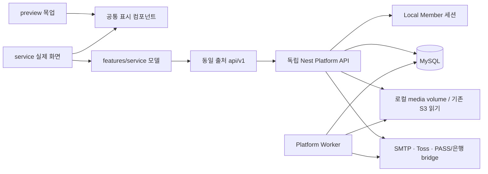

# 실제 서비스 구현 추적

역할별 출시 검수 기준은 프론트 `docs/release-test-scenarios.md`에 있다. 해당 검수의 미실행/차단 항목을 기존 로컬 테스트 결과로 통과 처리하지 않는다.

최종 목표: `/preview/*` 목업을 유지하고 `/service/*`에서 동일 표시 컴포넌트를 `/api/v1` 실제 DB API에 연결한다. Cognito 없는 자체 인증, MySQL, 단일 서버 배포. 외부 서비스 자격증명은 환경변수로만 주입한다.

## 계약

응답은 `{success,data,errorMessage,errorCode}`. 성공은 오류 필드 null, 실패는 data null. HTTP 상태코드는 유지한다. 새 API 접두어 `/api/v1`, 파괴적 변경은 `/api/v2`. 금액은 정수 KRW. 클라이언트 권한/가격/인증완료 플래그를 신뢰하지 않는다. 유료 미디어는 서버가 권한을 확인한 뒤 반환한다. 가입은 이메일 증명과 PASS 증명을 서버에서 검증한다.

## 작업 순서 / 완료 체크

- [x] DB 추가 모델과 migration, 격리된 개발 DB
- [x] 버전 API, 응답/오류, 자체 세션, 이메일 인증, PASS 공급자 경계
- [x] 팬: 피드/탐색/프로필/저장/좋아요/팔로우/댓글/메시지/알림/설정/문의/정책
- [x] 스튜디오: 시작/프로필/게시물/미디어/멤버십 버전/가입자/댓글/리포트
- [x] 결제: 서버 주문/결제수단/승인/멱등/구독/갱신/취소/환불
- [x] 정산 원장/계좌/출금 PIN/동시 요청 방지/배치
- [x] 실제 페이지 모델 바인딩 (fixture import 금지)
- [x] 로컬 HTTP/DB 통합검증, 프론트/백엔드 검사, 배포/설정 가이드

## 실행 / 추적 규칙

기존 미커밋 변경을 보존한다. 운영 DB는 절대 migration/seed하지 않는다. 개발은 별도 3307 포트 데이터 디렉터리와 생성한 개발 비밀값을 사용한다. 외부 계정 미설정 시 503 PROVIDER_NOT_CONFIGURED를 반환하며 가짜 완료/결제를 생성하지 않는다. 외부 발송/결제/은행송금 실행은 하지 않는다. 완료 검증과 남은 부분을 이 문서와 PROGRESS.md에 기록한다.

## 현재 코드 구조

- API 상세 계약: `docs/platform-api.md`; 외부 공급자 경계: `docs/provider-contracts.md`; 배포: `infra/platform/README.md`.
- DB 추가: 계정 설정/저장/차단/DM/알림/문의/서비스 문서, 가입 코드·PASS 시도/증명·동의 snapshot, 멤버십 버전, 암호화 billing key·서버 주문·수익 원장·정산 계좌·출금 PIN/authorization/request·worker job·팔로우 변경 이력. 기존 Member/Creator/Posting/Subscription 모델은 보존하고 필드를 추가한다.
- 20261007000000~20261007060000 추가 migration을 작성했다. 당시 기존 로컬 인증 migration을 포함해 격리 개발/테스트 DB에 총 9개 적용. 이후 결제 수명주기 migration이 추가됐으며 현재 파일 전체는 코드 추출 계약에 기록한다. 운영 DB에는 실행하지 않았다.
- 소유권/권한은 API에서 검증하고 핵심 결제·출금·게시물 발행은 행 잠금/transaction으로 처리한다. 이름뿐인 verified boolean을 브라우저에서 받아 처리하지 않는다.
- 가입 조건·정산 조건과 동의 약관 원문을 snapshot으로 고정한다. 과거 조건이 없는 구독은 확인 필요로 표시하며 갱신/권한에 임의 혜택을 만들지 않는다.
- 상태: 주문 pending/processing/paid/failed/refunding/refunded, 출금 requested/processing/paid/rejected. worker는 예약 발행/갱신 정책 재시도/불확실 승인·환불 조회/은행 상태 확인/한국 시간 일일 미디어 정리를 처리한다.

## 로컬 실행 상태와 재개

- 프론트: 127.0.0.1:3010, 기존 Next dev 하나. `/preview` 유지, `/service` 실제 API.
- API: 127.0.0.1:3001. `npm run build` 후 `npm run dev:platform`은 `.local/platform.env`만 읽는다.
- MySQL: 127.0.0.1:3307, `.local/mysql`/`.local/mysql.sock`, DB `crefans_platform_dev`와 `crefans_auth_test`. 생성한 개발 비밀값은 gitignore 대상 `.local/platform.env`에만 있다.
- backend 일반 `.env`는 기존 운영 DB 설정이므로 개발 실행/테스트에 로드하지 않는다. Prisma deploy도 런처에서 DATABASE_URL을 격리 DB로 명시했다.
- 플랫폼 worker는 `node -r dotenv/config dist/src/platform/worker.js dotenv_config_path=.local/platform.env`. 실제 은행 송금·미디어 삭제는 off.
- 프론트 build는 dev .next 손상을 피하려고 임시 checkout 복사본에서 검증한다. 새 실제 모델에 preview fixture import가 없다.

## 초기 구현 검증 기록 (2026-10-07, 최신 실행은 증거 파일 참조)

- 프론트 layer/type/test: 267개 통과. 외부 계정 없는 production Next build 통과(임시 복사본).
- 자체 인증 기존 통합 테스트: 12개 통과(별도 *_test DB, SMTP loopback 포함).
- 플랫폼 HTTP 통합 테스트: 13개 통과. 특히 프론트 3010의 `/api/v1` 프록시를 통해 재검증.
- 플랫폼 도메인: 이메일 증명/서명/가입·약관 snapshot 3개, 결제 snapshot/정확히 한 번 원장/출금 동시성/계좌 변경 차단/PIN 잠금/카드 재시도 6개, 미디어 dry-run/과거 버전 참조 보존/삭제 멱등 2개, 빌링 등록/암호화/재시도/폐기/비활성 계정 6개.
- 백엔드 Nest build·Prisma generate/migration deploy, Compose 설정 문법 통과.
- 브라우저: 실제 feed/login의 정상 데이터/빈 상태와 기존 `/preview/post/morning` 목업 유지 확인.
- 읽기 전용 개발 DB 이관 감사 7항목 모두 0. worker heartbeat `failures={}` 확인.
- 실제 외부 메일/PASS/결제/은행, 운영 DB, Docker 실제 이미지/TLS/복구/부하 검증은 실행하지 않았다.

## 운영 전 필요한 외부 입력·검증

이 체크리스트의 완료는 코드와 로컬 연결 범위다. 운영 출시 완료를 의미하지 않는다.

1. SMTP/Toss 계정·도메인·사업 정책 값 입력 후 공급사 테스트 환경 검증.
2. PASS/은행 공급자 계약 선택 후 공식 SDK를 내부 bridge에 연결. 계정값만 채우면 이 두 공급자 구현까지 완료되는 것은 아니다.
3. 약관/개인정보/운영 정책·활동 분야를 관리자 API로 등록, 첫 운영 관리자 지정.
4. 과거 회원·가입 당시 snapshot·billing key 암호화·기존 S3 비공개 이관. 이관 감사 CLI는 읽기 전용이다.
5. Docker 실행·TLS·볼륨 권한·DB/media 백업 복구·부하·장애/불확실 결제 운영 절차 검증.
6. 보조 목록의 대규모 서버 페이지 분리, 신규 관리자 UI·세무 증빙/월별 정산 기능은 현재 신규 목업 범위 밖이다.

### 2026-10-08 결제 수명주기 보완

중복 승인·응답 유실·DB 반영 실패·15일 경과 미확인 결제·카드 교체 재시도·갱신 중 해지·월말 갱신 anchor·이전 회차/현재 회차 환불·환불 결과 검증·출금 예약과 잔액 변경을 구현하고 격리 DB에서 검증했다. 테스트 명령은 `npm run build`, `npm run test:platform:domain`(54), 일반 API 실행 후 `npm run test:platform`(19), 프론트 `npm run check`(273). 상세 범위와 미결정 정책은 `provider-contracts.md` 결제 수명주기 검증 참조. 실제 공급사 테스트 및 전체97개 출시 검수는 별도다.

### Playwright E2E 테스트 런타임 (2026-10-08)

프론트 `playwright.config.ts`에서 `npm run build && node tests/e2e-server.cjs`를 실행한다. 테스트 전용 loopback API3012·제어 토큰·공급사 대역이며 운영 src/엔트리에서는 사용하지 않는다. 원본 .local/platform.env 연결이 127.0.0.1:3307/crefans_platform_dev인지 검사한 뒤 **crefans_platform_e2e**로만 연결을 전환한다. 별도 DB 생성/migration과 fixture 정리는 이 E2E DB에만 적용한다. migrate deploy는 임시 schema/migrations 복사본에서 실행해 일반 .env를 로드하지 않는다. 로컬 DB에 E2E schema만의 권한을 부여했고 운영 DB는 변경하지 않았다.

역할별 합성 회원·명시적 테스트 정책·멤버십/전용 글/카드/출금용 수익을 준비하고 각 테스트와 종료 시 해당 fixture만 정리한다. fixture 제어는 가입 코드/서명된 PASS 완료·승인 응답 유실/카드 거절·해당 구독 갱신·해당 출금 지급·세션 만료·첨부 권한을 재현한다. 운영 scheduler 전체 실행/실제 공급사 성공을 증명하지 않는다. 반복 명령·결과 파일·CI 준비는 프론트 docs/service-api-binding.md의 Playwright 절 참조. SIGKILL은 finally를 보장하지 않으므로 E2E DB에만 잔여 fixture를 확인한다.

### 클라우드·영상 화질 조사 (2026-10-08, 배포/구현 미실행)

전제: 한국 시청자를 중심으로 초기 출시, 자체 인증과 단일 앱 원서버 유지. 월 업로드 분량/시청 시간/동시 시청자/장애 복구 목표는 미확정이다. 아래 선택은 기술 권장안이며 계정별 견적·콘텐츠 허용 승인이 아니다.

현재 신규 영상 업로드는 media.controller.ts에서 MP4/WebM 최대300MiB의 컨테이너 헤더를 확인한 뒤 로컬 영속 volume에 파일 하나를 저장한다. 코덱 정규화/ffprobe 정밀 검사/자동 인코딩/HLS/ABR/CDN은 구현되어 있지 않다. 기존 S3 변환본 읽기는 신규 업로드 파이프라인과 별개이며 720p를 먼저 선택하는 코드다. 파일 GET/HEAD/Range 접근 검사는 기존 API 경유 상태다.

권장: AWS 서울 EC2에 현재 Next/Nest/worker를 유지하고 미디어는 비공개 S3+CloudFront로 분리. 자체 인증을 유지하며 Cognito를 다시 도입할 필요가 없다. DB까지 한 서버에 두는 초기 구성은 가능하지만 결제 원장의 복구를 위해 외부 백업/binlog/복원 검수 필요; 예산이 허용되면 RDS MySQL의 자동 백업/PITR와 Multi-AZ를 비교한다. 단일 앱 서버 자체의 장애점은 남는다. 영상 인코딩은 별도 queue/MediaConvert로 처리하여 결제 API와 CPU를 경쟁시키지 않는다. 한국 대상 국내 리전 선택과 전 세계 CDN 캐시의 개인정보 국외 처리 판단은 별도로 검토한다.

확인된 공급사 정보:
- AWS CloudFront 공식 가격: Free0달러/100GB, Pro15달러/월·10M요청·50TB·S3크레딧50GB, Business200달러/월·125M요청·50TB·S3크레딧1TB. Pro에는 uptime SLA가 없고 Business에는 있다. 가격은 distribution 단위이며 EC2/DB/인코딩/초과 저장/세금 등 전체 제품 비용이 아니다. 계정 eligibility와 기능 제약 확인 필요. 정액 allowance 초과 요금이 없더라도 지속 초과 시 성능 조정/가격 구조 변경 가능하므로 무제한 영상 서비스로 해석하지 않는다.
- NCP 공식 한국 요금표: Global Edge 한국 전송0~10TB84원/GB, 요청10,000건당10원, 선택 OriginShield18원/GB, VAT별도. VOD Station AVC30fps 이하1-pass 출력 분당 SD9원/HD17원/FHD32원. 저장·채널/CDN 등 별도. 공식 페이지의 동적 표는 검색에 색인된 공식 표로 교차 확인했으며 계약 전 콘솔/견적 재확인 필요.
- Cloudflare Stream: 인코딩/패키징/배포를 관리하고 HLS/DASH 및 서명 인증 제공. 저장1,000분당5달러, 전송1,000분당1달러. 앱/DB 호스팅과 별개인 영상 서비스이며 데이터 위치/콘텐츠 허용/최대 화질 요구를 확인해야 한다. 관리 부담 최소화 대안이다.

화질 권장: 원본1개를 비공개 보관하고 1080/720/480급 HLS 변환본을 생성, 기본 자동+고화질 수동 선택. 세로 영상은 비율/회전을 유지하고 원본보다 확대하지 않는다. 4K/복수 코덱/DRM은 요구와 비용 확인 후 별도 판단. 480급은 나쁜 네트워크에서 재생을 유지하기 위한 fallback이며 유료 회원에게 낮은 화질을 강제하는 정책이 아니다. Apple HLS 지침은 복수 비트레이트를 요구하며 ABR은 대역폭에 맞춰 선택한다. 출시 소규모 임시 단계에는 정규화된 단일 MP4도 가능하나 ABR 제공으로 표시해서는 안 된다.

계산 예시(측정/견적 아님): 영상 비트레이트6/3/1Mbps·10분은 오디오/패키징 제외450/225/75MB. 시청 시 세 화질을 모두 내려받는 것이 아니므로 저장량 증가는 시청 전송량3배를 뜻하지 않는다. 6Mbps10분을1만 번 끝까지 보면 약4,500GB, NCP 첫 구간 전송료만378,000원(VAT/요청/저장/인코딩/채널 제외). NCP 동일10분3출력 단일패스 인코딩은 (32+17+9)*10=580원에 별도 비용. 저장 원본의 비트레이트는 예시와 다를 수 있다.

권한 경계: 비공개 S3 원본은 OAC를 통해 CDN에서만 읽고, 서버가 현재 작성자/해당 상품 구독/공개 기간/성인 인증/계정 상태를 확인한 후 해당 미디어 경로의 짧은 재생 권한을 발급한다. HLS master/variant playlist/segment와 암호화 시 key까지 보호한다. AWS는 복수 HLS 파일에 signed cookies를 권장한다. 여러 유료 미디어가 한 피드에 있는 경우 경로별 Cookie/CORS/권한 범위 충돌 검증 필요, 단일 blanket 권한을 부여하지 않는다. 기존 private,no-store API 정책은 유지하되 CDN은 인증을 통과한 파일만 공유 캐시하도록 별도 설계해야 한다. 서명은 bearer 권한이므로 만료 전 공유/권한 철회 지연이 생길 수 있으며 짧은 TTL+재검사, 즉시 차단 요구 시 edge 검증이 필요하다. DRM/복제 방지와 접근제어는 구분한다.

기존 성인 콘텐츠 질문 관련: AWS AUP는 불법 활동·권리 침해·아동 성착취 등을 금지한다. 합법 성인 콘텐츠 전체가 허용된다고 보장하는 문구로 해석하지 않는다. 국내 정보통신망법44조의7(시행2026-07-07)은 음란 정보 유통을 금지한다. 성인 인증/유료 접근/해외 저장만으로 허용 여부를 결정할 수 없다. 실제 콘텐츠 유형을 확정한 뒤 공급사/PG 허용 범위와 해당 운영 법률 적용을 확인해야 한다. NCP의 검색된2021 약관 PDF를 현행 계약으로 단정하지 않았다.

공식 근거(확인일2026-10-08):
- [CloudFront 요금](https://aws.amazon.com/cloudfront/pricing/), [정액 요금 eligibility/제약/초과 정책](https://docs.aws.amazon.com/AmazonCloudFront/latest/DeveloperGuide/flat-rate-pricing-plan.html), [AWS Service Terms3.2](https://aws.amazon.com/service-terms/)
- [NCP 한국 요금표](https://www.ncloud.com/charge/region/ko), [Global Edge 인증](https://guide.ncloud-docs.com/docs/en/globaledge-overview)
- [MediaConvert 요금/출력별 과금](https://aws.amazon.com/mediaconvert/pricing/), [서울 지원](https://docs.aws.amazon.com/general/latest/gr/mediaconvert.html)
- [Cloudflare Stream 요금](https://developers.cloudflare.com/stream/pricing/), [영상 처리](https://developers.cloudflare.com/use-cases/media-streaming/video-delivery/)
- [Apple HLS](https://developer.apple.com/streaming/), [HLS 저작 지침](https://developer.apple.com/documentation/http-live-streaming/hls-authoring-specification-for-apple-devices/)
- [S3 OAC](https://docs.aws.amazon.com/AmazonCloudFront/latest/DeveloperGuide/private-content-restricting-access-to-s3.html), [signed cookies 선택](https://docs.aws.amazon.com/AmazonCloudFront/latest/DeveloperGuide/private-content-choosing-signed-urls-cookies.html), [서명 만료](https://docs.aws.amazon.com/AmazonCloudFront/latest/DeveloperGuide/private-content-signed-cookies.html)
- [RDS 자동 백업/PITR](https://docs.aws.amazon.com/AmazonRDS/latest/UserGuide/USER_WorkingWithAutomatedBackups.html), [Multi-AZ](https://docs.aws.amazon.com/AmazonRDS/latest/UserGuide/Concepts.MultiAZSingleStandby.html)
- [AWS AUP](https://aws.amazon.com/aup/), [정보통신망법44조의7](https://www.law.go.kr/lsLawLinkInfo.do?chrClsCd=010202&lsJoLnkSeq=1000085004)

남은 사업 판단: 최대 제공 화질/원본 보관 기간·월 업로드/시청 예산·DB/앱 장애 복구 목표·콘텐츠 범위·서명 철회 지연 허용 범위. 이번에는 코드/클라우드 자원/외부 계정/배포를 변경하지 않았다.

### 성장 단계별 월 인프라 예산 계산 (2026-10-08)

사용자 조건: 초기5/중간50/대형100/초대형1000 구독자 크리에이터가 동일 비율. 총 크리에이터 수가 주어지지 않아4/40/100명 가정. 4명마다 구독1155건, 평균288.75건/크리에이터. 동일 팬의 복수 구독은 중복 포함하며 아래 시청량은 각 구독 관계당 가정이다. 월 시청100/300분, 평균 전달4Mbps(화질별 실제 평균은 미측정), 전송 여유10%,6초HLS영상조각·요청 여유20%. 별도 audio segment·썸네일·앱/API 요청이 늘어나면 요청량이 더 커질 수 있다.

업로드: 크리에이터마다 월10분 영상4개=40분. 원본4Mbps+재생4/2/1Mbps 합계11Mbps, 월3.3GB·6개월 누적19.8GB/명, 과거 전체6개월분을 월말까지 보관하는 보수적 모델. 이미지·실제 원본 고비트레이트·버전 복제·전 기간 보관은 추가된다. 원본10분4Mbps는 약300MB여서 현재300MiB 업로드 제한과 맞지만 고비트레이트면 제한 변경 필요.

소형 비용 모델: AWS서울 Lightsail IPv4 Linux4GB24달러/8GB44달러/16GB84달러에 Next/Nest/MySQL/worker, 영상은비공개S3+CloudFront+MediaConvert. 기존 EC2권장안을 자본금 없는 초기의 VM고정비 관점에서 Lightsail 대안으로 계산한 것이며 실제 이전/성능 검증은 하지 않았다. DB같은VM은 외부 백업/로그 복원 검증 필수; VM규격은 예산 가정이고 해당 회원 규모의 처리능력 보장이 아니다. 운영서비스는 production build로 실행, 같은서버에서 영상변환하지 않음. 영상트래픽을 Lightsail 포함전송량으로 계산/프록시하지 않는다.

공식 AWS 서울 Price List(2026-10-08 조회): MediaConvert Basic AVC30fps 이하 SD/HD 정상화분단가0.0085달러, HD승수2/SD1. 1080/720/480 세출력은 40*(2+2+1)*0.0085=1.70달러/명/월. S3Standard첫50TB0.025달러/GB월, GET0.00000035달러/건·PUT0.0000045달러/건. Lightsail snapshot0.05달러/GB월. 백업 예산4/40/100명별5/10/15달러, 요청/메일/로그 등 소규모 예비비5/10/15달러를 임의 편성. 실제 원본 분량/요청 cache miss/SMTP 서비스 요금/backup 증가에 따라 달라진다. CloudFront S3storage크레딧은 아래 예산에서 빼지 않아 보수적이며 적용 시 낮아진다. domain등록비·PASS·PG/은행비용·인건비·운영 HA/관리형DB 제외, 무료체험/프로모션 미반영.

환산은 현재환율확정값이 아닌 예산환율1달러1400원+VAT10%=1540원/달러. 공식값·가정·계산값 구분.

| 총크리에이터 | 각등급인원 | 구독합계 | 월100분전송TB/요청M | 월100분 총USD/예산KRW | 월300분전송TB/요청M | 월300분 총USD/예산KRW |
| --- | --- | --- | --- | --- | --- | --- |
|4|각1|1155|3.8115/1.386|57.78/88981|11.4345/4.158|57.78/88981|
|40|각10|11550|38.115/13.86|351.80/541772|114.345/41.58|2401.80/3698772|
|100|각25|28875|95.2875/34.65|2583.50/3978590|285.8625/103.95|6333.50/9753590|

CDN구성:4명Pro15달러;40명100분Business200달러(요청10M초과),300분Premium125TB2250달러;100명100분Premium125TB2250달러,300분Premium350TB6000달러. 영상외앱트래픽이 같은distribution이면 추가 고려. 이는 sustained예상 사용량에 맞춘 보수적 plan선택이며 allowance넘는즉시자동청구/업그레이드가 발생한다는 뜻이 아니다. 공식은 초과추가요금없음/일회성급증허용/지속초과성능조정가능이라고 안내한다. 50TB 넘는다고 비용이 선형 증가하지 않는 구간을 강조한다. 대규모에는 negotiatedCDN/다른영상서비스 및 실제 시청 평균으로 재견적해야 하며 위 Premium가격이 유일한필수비용은 아니다.

4명100분57.78달러 내역:VM24+CDN15+인코딩6.80+영상저장1.98+백업5+요청/메일/로그예비5.40명100분:VM44+CDN200+인코딩68+저장19.80+백업10+예비10.100명100분:VM84+CDN2250+인코딩170+저장49.50+백업15+예비15.

민감도:100명/월100분의 실제평균전달률이2Mbps면47.64375TB·요청34.65M, Business200달러로총533.50달러=821590원(약82만원)이 된다. 평균4Mbps의약398만원과큰차이이며 시청동작/자동화질의 실제측정없이 특정비용을확정하면안된다. 40명/100분10초조각은 예시 요청8.316M으로Pro기준에들어올수있지만 재생/탐색 품질 및앱/추가요청 검수 없이 이 값을확정하지않는다.

자본금없는초기제안:크리에이터1~4/구독5~100건의초기검증은VM24+CDN15+외부백업/소규모요청/영상변환으로월8~10만원정도를예산에둔다. Pro SLA없음, 앱/DB VM단일장애점이남음. 원격무료운영/정식출시가능성을보장하지않는다. 월10분4개등업로드량한도, 고화질원본무제한보관하지않기(보존정책먼저확정), 화면밖전체영상미리받기금지, 영상은CDN에서만전송. 비용경보50/80/100%, 업로드쿼터/변환작업한도/스토리지추이모니터링을권장; AWSBudget알림은자동과금상한이아니다. 추후실제지표에따라DB분리와CDN계약재검토. 변환본이세개라는이유로시청전송량3배가되지않는다.

근거(조회2026-10-08): [Lightsail 요금](https://aws.amazon.com/lightsail/pricing/), [CloudFront 요금](https://aws.amazon.com/cloudfront/pricing/), [계획별요청/전송 allowance·Premium상위용량](https://docs.aws.amazon.com/AmazonCloudFront/latest/DeveloperGuide/flat-rate-pricing-plan.html), [MediaConvert정상화승수](https://aws.amazon.com/mediaconvert/pricing/), [서울MediaConvert 공식 Price List](https://pricing.us-east-1.amazonaws.com/offers/v1.0/aws/AWSElementalMediaConvert/20260911134114/ap-northeast-2/index.json), [서울S3 공식 Price List](https://pricing.us-east-1.amazonaws.com/offers/v1.0/aws/AmazonS3/20260928230416/ap-northeast-2/index.json). 이번에는 비용계산/문서기록만했으며구매/배포/과금설정변경없음.
